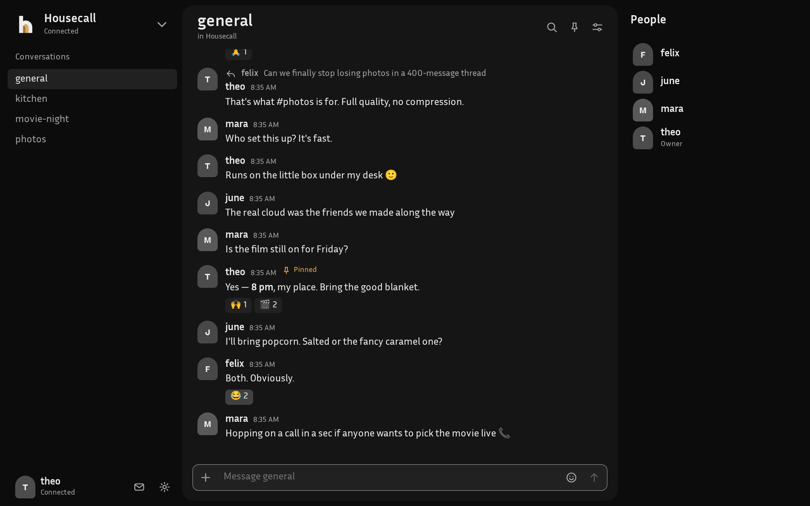
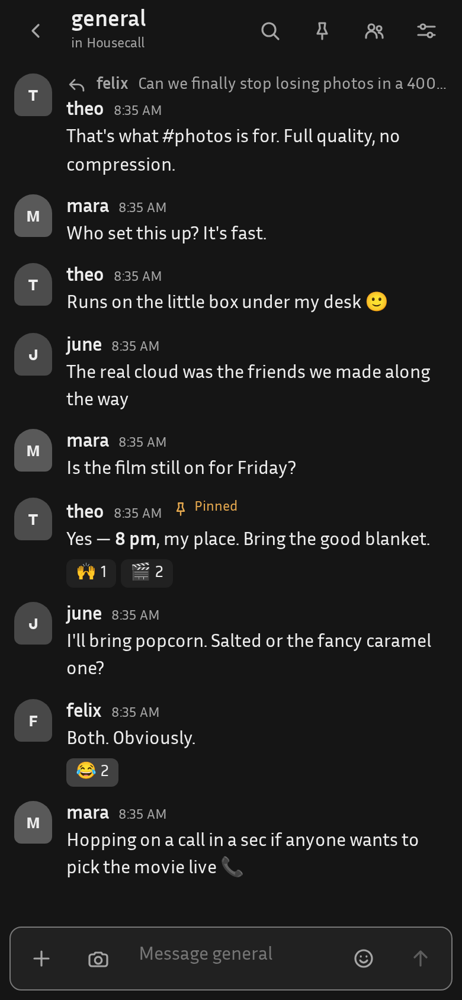
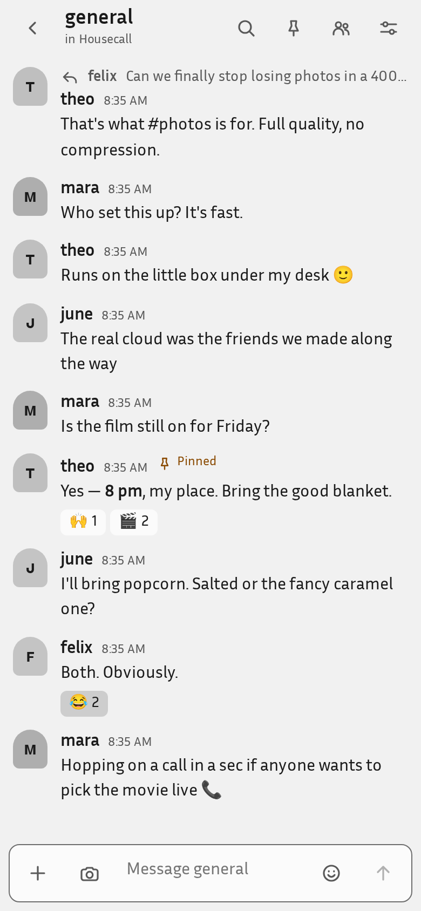

<div align="center">


# HouseCall

**Chat, calls and watch-together for your friends and community.**

Run your own community server, invite your people, and keep conversations together across the web and native apps.

[](https://github.com/strnadchristopher/housecall/releases)
[](LICENSE)
[](#download)
[](#quick-start-docker-compose)
<br>
[](server)
[](client)
[](client/src-tauri)
[](CONTRIBUTING.md)

[](https://ko-fi.com/strnadchristopher)

[**Quick start**](#quick-start-docker-compose) · [**Features**](#features) · [**Download**](#download) · [**Docs**](docs/SETUP.md) · [**Security**](SECURITY.md)

<br>

<picture>
  <source media="(prefers-color-scheme: light)" srcset="docs/readme/desktop-light.png">
  
</picture>

<br><br>

&nbsp;&nbsp;


</div>

---

## Why HouseCall?

HouseCall gives a small community its own place to talk. The host controls membership and integrations, with channels, direct messages and shared activities in one app.

- **Membership you approve.** Share an invite link, or review access requests. Community access requires an invitation or approval.
- **Yours to run.** One Docker Compose file, one SQLite database, no third-party account.
- **Web and native clients.** Use a browser or the Tauri apps; mobile apps are still in testing.

## Open HouseCall

Visit [housecall.chat](https://housecall.chat) for the project, or [connect directly](https://housecall.chat/app/)
with the community server address your host gave you. The portal reviews that address and opens
the server's own frontend, where you log in and join under that host's rules.

An optional [HouseCall account](https://housecall.chat/app/#account) saves an encrypted list of
server addresses. It does not create a community login or grant membership. Registration depends
on the account service's availability and operator review; direct connection needs no portal account.
There is **no portal password reset or recovery**. Keep your password safe and export your list
while it is unlocked if you need a backup. Reloading the page locks the list again.

Private managed hosting is **in preparation**. Availability, service terms and pricing have not
been announced. Self-hosting instructions are below.

## Features

| | |
|---|---|
| 💬 **Chat** | Channels, DMs and group DMs, threaded replies, @mentions, reactions, pins, search, markdown, link previews |
| 📞 **Voice & video** | Group calls on a built-in Rust SFU, camera and screen sharing, ringing for direct calls, native CallKit on iOS |
| 🍿 **Watch together** | Synced Plex playback with subtitles, a shared DJ queue, GIFs via Giphy |
| 📸 **Snaps** | View-once photos that open once per person and expire after 24 hours |
| 🖼️ **Media** | Inline images, GIFs and video; resumable uploads encrypted at rest; ordinary files stay quarantined until scanning succeeds |
| 🔐 **Security & accounts** | Encrypted one-to-one DMs when both people have security keys; community passwords and passkeys, native OS credential storage, owner controls and access requests |
| 🧭 **Setup wizard** | Create a server, pick channels, and check every integration from Settings |
| 🔄 **Auto-updates** | Signed desktop updates, downloaded in the background |

## Download

Desktop builds for **macOS** (universal `.dmg`), **Windows** (`.exe`) and **Linux** (`.AppImage`, `.deb`) are on the
[**Releases**](https://github.com/strnadchristopher/housecall/releases) page. The iOS and Android apps are in testing
and build from `client/src-tauri`. Housecall is pre-release software: expect rough edges and breaking changes.

## Quick start (Docker Compose)

Requirements: Docker with the Compose plugin and Python 3. Clone this repository and
run the following from its root. This builds the source; older prebuilt server images
do not automatically include the current publication fixes.

```sh
python3 scripts/init-env.py        # creates .env with random secrets
```

Edit `.env` and set `HOUSECALL_ORIGIN` and `HOUSECALL_PUBLIC_URL` to the address people will
use, for example `https://chat.example.com`. Then:

```sh
docker compose up -d --build
```

The app listens on `127.0.0.1:4317`; put a reverse proxy with HTTPS in front of it. If your
proxy runs in Docker, see `compose.proxy.yaml`. Open the site, use the setup token from `.env`
to create the owner account, then remove the token from `.env`.

Invitations work without email: the owner creates one and shares the returned link. Mail is
sent only if you configure `RESEND_API_KEY` and `HOUSECALL_MAIL_FROM`.

Voice and video media uses UDP on `SFU_PORT` and does not go through the reverse proxy; see
the comments in `.env.example`. Apps (Plex, Gimme, Switchboard, Giphy, push) are off
until you configure them.

More: [setup](docs/SETUP.md), [API](docs/API.md), [threat model](docs/THREAT-MODEL.md),
[contributing](CONTRIBUTING.md).

## Security status

> [!WARNING]
> Channels, group DMs and calls are **not end-to-end encrypted**. The server operator can read
> their messages, decrypt ordinary uploads and access call media. One-to-one DMs and their sealed
> attachments use client-side encryption when both people have security keys. First contact trusts
> the supplied keys: compare safety numbers. There is no forward secrecy, and older plaintext
> messages remain plaintext. A host serving a modified web client can read what that browser can
> access, including keys entered or linked there. Native clients reduce that web-publisher exposure
> but still depend on trusted software and devices.

Ordinary upload encryption uses a key held by the server; it does not hide files from the operator.
Sealed DM attachments cannot be scanned by the server. Operators can see membership, message
timing, sizes and other metadata. View-once photos cannot prevent recipients from copying them.
The optional portal encrypts your saved list in the browser, but a compromised site or browser can
read it while unlocked. Host, proxy, provider and backup policies also affect privacy.

The encryption has had no independent external audit. Read [SECURITY.md](SECURITY.md), the
[bounded November 2026 source review](docs/security/SECURITY-AUDIT-2026-11.md), and the
[privacy explanation](https://housecall.chat/privacy) before choosing a host.

## Built with

**Server:** Rust, axum, SQLite, a built-in WebRTC SFU · **Client:** React 19, TypeScript, Vite · **Apps:** Tauri 2 (desktop, iOS, Android)

## Contributing

Bug reports, ideas and pull requests are welcome. Start with [CONTRIBUTING.md](CONTRIBUTING.md)
for source builds and development. Report vulnerabilities privately through the route in
[SECURITY.md](SECURITY.md), rather than a public issue.

## Support the project

If Housecall brings your people a little closer, you can say thanks on Ko-fi. It keeps the kettle on and the servers running.

<a href="https://ko-fi.com/strnadchristopher"></a>

## Share

[](https://x.com/intent/post?text=Housecall%3A%20a%20private%20group%20chat%20you%20host%20yourself&url=https%3A%2F%2Fgithub.com%2Fstrnadchristopher%2Fhousecall)
[](https://bsky.app/intent/compose?text=Housecall%3A%20a%20private%20group%20chat%20you%20host%20yourself%20https%3A%2F%2Fgithub.com%2Fstrnadchristopher%2Fhousecall)
[](https://www.reddit.com/submit?url=https%3A%2F%2Fgithub.com%2Fstrnadchristopher%2Fhousecall&title=Housecall%3A%20a%20private%20group%20chat%20you%20host%20yourself)
[](https://news.ycombinator.com/submitlink?u=https%3A%2F%2Fgithub.com%2Fstrnadchristopher%2Fhousecall&t=Housecall%3A%20a%20private%20group%20chat%20you%20host%20yourself)
[](https://www.linkedin.com/sharing/share-offsite/?url=https%3A%2F%2Fgithub.com%2Fstrnadchristopher%2Fhousecall)

## License

[GNU AGPL-3.0](LICENSE). If you distribute builds, provide the corresponding source as required
by the licence. If you modify HouseCall and let people use it over a network, offer those users
the corresponding source for your modified version. See the licence for the full terms.
